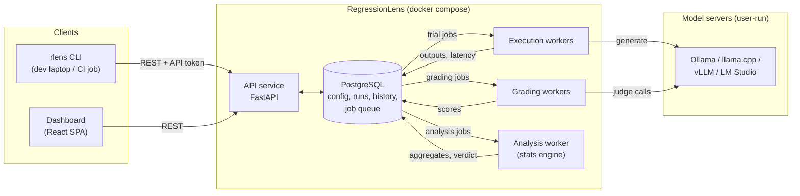
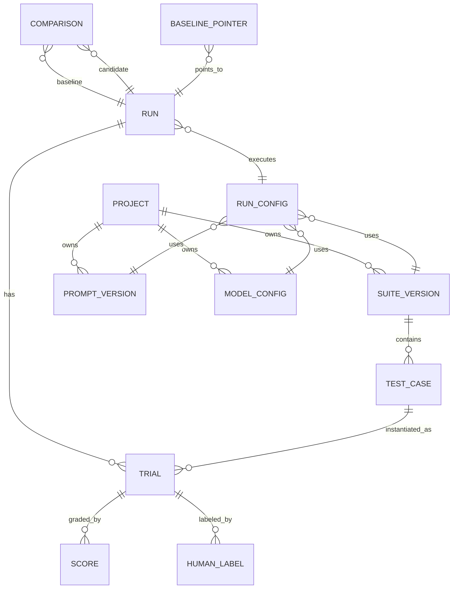
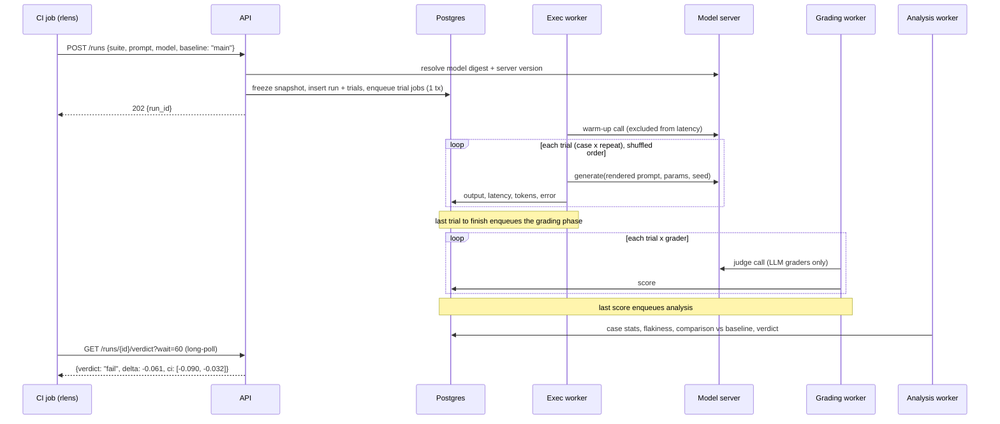
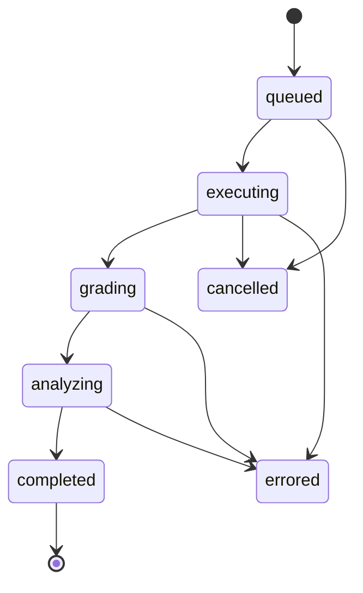

# RegressionLens — Architecture

> Working name from the problem statement. This document describes the target
> architecture; the build plan at the end orders the work.

## 1. What the system must do

The platform answers one question for a developer or CI pipeline: **"Is this
change to my prompt, model, or settings safe to ship?"** It answers with a verdict
it can back with statistics.

| Requirement (problem statement) | Where it lives in this design |
|---|---|
| Run tests repeatedly; record outputs, latency, exact config | Execution worker, `trials` table, immutable **config snapshot** (§4, §5) |
| Exact-match, schema-validity, model-based graders | Grader registry (§7) |
| Paired statistical comparison with confidence intervals | Statistics engine (§8) |
| Flag flaky tests | Flakiness analysis (§8.5) |
| Pass/fail verdict through an API for CI | Verdict endpoint + `rlens` CLI (§12) |
| Full history and trend views | Baselines, trends API, dashboard (§11, §13) |
| Grader reliability vs human labels | Labeling + calibration module (§9) |
| Reproduce any past result | Config fingerprints + re-score / re-run (§10) |
| Success criteria are *measured* | `experiments/` validation harness (§15) |

### Design principles

1. **Every result points to one frozen config.** A run references an immutable,
   content-hashed snapshot of the prompt text, model digest, sampling parameters,
   suite version, and grader versions. Nothing about a past run is looked up
   "by name" later.
2. **The test case is the unit of statistics, not the individual call.** Repeats of
   one case are correlated. If you treat them as independent samples, you get too
   much confidence and false alarms.
3. **The verdict has three states: pass, fail, inconclusive.** When the evidence is
   too weak, the system says so and tells you how many more cases or repeats you
   need. It does not guess.
4. **Graders are tested too.** A model-based grader carries an agreement score
   against human labels, and the verdict shows whether its grader is calibrated.
5. **Keep infrastructure small.** This is a single-node tool for small teams. Its
   only stateful dependency is Postgres, and the model servers belong to the user.

---

## 2. System overview



| Component | Responsibility |
|---|---|
| **API service** | CRUD for suites, prompts, model configs. Starts runs: resolves refs, freezes the config snapshot, creates trials, and enqueues jobs. Serves verdicts, comparisons, trends, and labels. Also serves the built dashboard as static files. |
| **Execution workers** | Render the prompt for each trial (case × repeat), call the model through a provider adapter, and record output, latency, tokens, seed, and errors. Concurrency is limited per model endpoint. |
| **Grading workers** | Apply each case's graders to the stored outputs. Deterministic graders are cheap. LLM-judge graders call a pinned judge model. |
| **Analysis worker** | A pure stats engine. It computes per-case and per-tag aggregates, flakiness, the paired comparison against the baseline, the power/MDE hint, and the final verdict. |
| **PostgreSQL** | System of record. It also holds the job queue, so a run and its jobs are created in one transaction. |
| **rlens CLI** | Syncs suites-as-code from the user's repo, starts runs, waits for the verdict, and exits with a CI-friendly code. |
| **Dashboard** | Run browser, comparison view, trends, per-case history, and the labeling UI. |

---

## 3. Technology choices

| Layer | Choice | Why |
|---|---|---|
| Language (backend, CLI) | Python 3.12 | The stats (NumPy/SciPy) and LLM-client ecosystems are here, and one language covers API, workers, and CLI. |
| API | FastAPI + Pydantic v2 | Typed request/response models. The generated OpenAPI spec is used by the CLI and dashboard. |
| Database | PostgreSQL 16, SQLAlchemy 2, Alembic | JSONB for config snapshots and raw responses; relational queries for history and trends. |
| Job queue | Postgres-backed queue (`procrastinate`, built on `SKIP LOCKED` + `LISTEN/NOTIFY`) | No Redis. Enqueueing is transactional with run creation. Throughput is far beyond what a local GPU can consume. |
| HTTP to models | `httpx` (async) | Workers are I/O-bound on model-server calls. |
| Stats | NumPy, SciPy | Bootstrap, permutation tests, McNemar, kappa. |
| Schema grading | `jsonschema` | Standard JSON Schema validation. |
| Dashboard | React + TypeScript + Vite, TanStack Query, Recharts | A thin client over the REST API. Charts for trends and CI forest plots. |
| CLI | Typer + httpx | Packaged as `pip install regressionlens-cli`. |
| Packaging | Docker Compose | `postgres`, `api`, `worker`, optional `ollama`. |

The queue sits behind a small `JobQueue` interface. If the project ever outgrows
Postgres, a Redis-based queue can replace it without touching the workers.

---

## 4. Core concepts and data model

### 4.1 Concepts

- **Project**: a tenant boundary that owns everything below and its API tokens.
- **Suite version**: an immutable set of **test cases**, versioned by the content
  hash of the canonicalized suite file. Uploading identical content returns the
  existing version.
- **Test case**: a stable `case_key` (stable across suite versions so history can
  follow it), input variables, an optional expected value, graders, tags, and a
  `critical` flag.
- **Prompt version**: system prompt plus a Jinja2 user template, content-hashed.
- **Model config**: provider, endpoint, model tag, the **resolved model digest**,
  and sampling parameters (temperature, top_p, top_k, max_tokens, num_ctx, stop).
- **Run config (snapshot)**: suite version + prompt version + model config +
  resolved grader configs + execution settings (repeats, seed policy, timeouts) +
  environment fingerprint. Its **fingerprint** is the sha256 of its canonical
  JSON. Two runs with the same fingerprint are identical configs, which is the
  basis for A/A tests.
- **Run**: one execution of a run config. Holds status, progress counters, CI
  metadata (git sha, branch, PR), and timestamps.
- **Trial**: one model call, `(run, case, repeat_index)`. Stores the rendered
  prompt, output, latency, token counts, seed, error, and raw response.
- **Score**: one grader's result on one trial. Holds a value in `[0,1]`, a pass
  flag, a rationale, and the grader version.
- **Comparison**: baseline run vs candidate run. Holds per-metric deltas with CIs,
  p-values, case-level diffs, the config diff, and the verdict.
- **Baseline pointer**: a named, movable reference to a run (for example `main`),
  scoped to a suite.
- **Human label**: a person's judgment on a trial, used to calibrate graders.

### 4.2 Entity relationships



### 4.3 Key tables

| Table | Key columns |
|---|---|
| `suite_versions` | `id, project_id, name, content_hash, spec JSONB, verdict_policy JSONB, created_at` |
| `test_cases` | `id, suite_version_id, case_key, input JSONB, expected JSONB, graders JSONB, tags text[], critical bool` |
| `prompt_versions` | `id, project_id, name, system_text, template_text, content_hash` |
| `model_configs` | `id, project_id, provider, endpoint, model_tag, model_digest, params JSONB, content_hash` |
| `run_configs` | `id, fingerprint UNIQUE, snapshot JSONB, suite_version_id, prompt_version_id, model_config_id` |
| `runs` | `id, run_config_id, status, total_trials, executed, graded, ci_meta JSONB, started_at, finished_at, summary JSONB` |
| `trials` | `id, run_id, case_id, repeat_idx, seed, rendered_prompt, output, latency_ms, ttft_ms, tokens_in, tokens_out, error, raw JSONB` |
| `scores` | `id, trial_id, grader_id, grader_version, value float, passed bool, rationale, judge_trial JSONB` |
| `comparisons` | `id, baseline_run_id, candidate_run_id, metrics JSONB, case_diff JSONB, config_diff JSONB, verdict, policy JSONB` |
| `baselines` | `project_id, suite_name, name, run_id, updated_at, updated_by` |
| `case_stats` | `run_id, case_key, metric, mean, n, flaky bool` (materialized for fast trends and per-case history) |
| `human_labels` | `id, trial_id, grader_id, label float, labeler, created_at` |
| `api_tokens` | `id, project_id, token_hash, scopes, created_at, revoked_at` |

### 4.4 The config snapshot (what "reproducible" means concretely)

```jsonc
{
  "suite":   { "name": "support-qa", "content_hash": "sha256:…", "case_keys": ["…"] },
  "prompt":  { "system": "<full text>", "template": "<full text>", "content_hash": "sha256:…" },
  "model":   {
    "provider": "ollama", "endpoint": "gpu-box", "tag": "llama3.1:8b-instruct-q4_K_M",
    "digest": "sha256:…",                       // resolved at run start, not a mutable tag
    "params": { "temperature": 0.7, "top_p": 0.9, "max_tokens": 512, "num_ctx": 4096 }
  },
  "graders": [
    { "id": "exact", "type": "exact_match", "version": "1.0", "config": { "normalize": ["strip","lower"] } },
    { "id": "judge", "type": "llm_judge", "version": "1.2",
      "config": { "rubric": "<full text>", "judge_model": { "tag": "qwen2.5:14b", "digest": "sha256:…",
                  "params": { "temperature": 0, "seed": 0 } } } }
  ],
  "execution": { "repeats": 5, "seed_policy": "derived", "run_seed": 1234, "timeout_s": 120,
                 "retries": 2, "endpoint_concurrency": 1 },
  "environment": { "provider_version": "ollama 0.x.y", "platform_version": "<git sha>" },
  "stats": { "alpha": 0.05, "bootstrap_B": 10000, "method": "paired_cluster_bootstrap" }
}
```

---

## 5. Run lifecycle

### 5.1 Sequence (CI-triggered run)



### 5.2 Run states



### 5.3 Execution details that matter

- **Phase separation.** All trials run first, then grading starts. On a single
  local GPU, interleaving the candidate model with a different judge model makes
  Ollama keep loading and unloading weights. That is slow and it distorts latency.
- **Phase barrier.** Each worker increments `runs.executed` (or `runs.graded`)
  with `UPDATE … RETURNING`. The worker that sees `executed = total_trials`
  enqueues the next phase. No polling, no extra coordinator.
- **Per-endpoint concurrency.** Trial jobs go onto a queue named after the model
  endpoint. That queue's worker concurrency is the endpoint's configured
  parallelism (default 1 for one local GPU). The concurrency level is stored in the
  snapshot because batching affects both latency and output determinism.
- **Shuffled order.** Trials run in a seeded random order, so time-dependent
  effects (thermal throttling, other GPU load) spread evenly across cases.
- **Seeds.** Under `seed_policy: derived`, repeat *i* of case *c* uses
  `seed = H(run_seed, case_key, i)`. Repeats still vary, but each trial's seed is
  recorded and can be replayed.
- **Latency.** A warm-up call per endpoint runs before timing. The worker records
  wall-clock latency, time to first token (when streaming), and provider-reported
  durations with model load time excluded.
- **Errors and retries.** Transient failures (connection refused, 5xx, timeouts)
  are retried with backoff. A trial that still fails after retries counts as a
  failed trial and adds to `error_rate`. Jobs are keyed by `trial_id`, so a
  redelivered job is safe.
- **Cancellation.** Cancelling sets `runs.status = cancelled`. Workers check it
  before each call and drop remaining jobs.

---

## 6. Model providers

There is one interface, so workers never know which server they talk to:

```python
class Provider(Protocol):
    async def resolve(self, model_tag: str) -> ModelIdentity: ...   # digest, quantization, server version
    async def generate(self, req: GenerateRequest) -> GenerateResult: ...  # text, timings, tokens, raw
```

| Adapter | Notes |
|---|---|
| `ollama` | `/api/chat`, with sampling params and `seed` passed through `options`. `/api/show` and `/api/tags` give the digest; `/api/version` gives the server version. Supports `format` (JSON schema) for structured outputs. |
| `openai_compat` | Covers llama.cpp server, vLLM, and LM Studio. Model identity comes from `/v1/models` plus user-supplied metadata when no digest is exposed. |
| `simulated` | A deterministic fake with configurable per-case success probabilities and latency. It gives a known ground truth for testing the stats engine, the false-alarm rate, and the whole pipeline in CI without a GPU. |

Endpoints are named in configuration (for example `gpu-box →
http://10.0.0.5:11434`), so a snapshot records a logical endpoint plus the
resolved model identity, not a raw URL.

---

## 7. Graders

Graders are registered plugins with a **version**. Changing a grader's behavior
bumps its version, which changes the run fingerprint, so runs scored by different
grader versions are never silently compared.

| Grader | Output | Notes |
|---|---|---|
| `exact_match` | pass/fail | Optional normalization: strip, lowercase, collapse whitespace, strip punctuation. |
| `contains` / `regex` | pass/fail | Can match all or any of several patterns. |
| `choice` | pass/fail | Extracts a label from free text (for example "yes/no", A–D) and then compares it. |
| `numeric` | pass/fail | Parses a number and compares it within an absolute or relative tolerance. |
| `json_schema` | pass/fail | Parses JSON (optionally pulling it out of a code fence) and validates it against the schema. |
| `json_field` | pass/fail | A JSONPath into the parsed output, compared to the expected value. |
| `llm_judge` | pass/fail or 1–5 scale normalized to [0,1] | Pinned judge model (digest, temperature 0, seed), rubric text stored in the snapshot, structured output (`{verdict, score, rationale}`), and optional reference answer. It warns when the judge model equals the model under test (self-preference bias). |

**Trial pass rule.** A trial passes when all of its *required* graders pass.
Each grader also produces its own metric, so a run reports `pass_rate`, plus
`json_schema.valid_rate`, `judge.mean_score`, and so on.

### Suite file (suites-as-code, lives in the user's repo)

```yaml
name: support-qa
graders:                       # defaults applied to every case
  - id: exact
    type: exact_match
    normalize: [strip, lower]
verdict:
  primary_metric: pass_rate
  alpha: 0.05
  non_inferiority_margin: 0.02 # tolerated drop for a PASS (2 points)
  min_effect: 0.0              # ignore statistically-significant drops smaller than this
  gates:
    - { metric: json_schema.valid_rate, min: 0.99 }
  inconclusive: warn           # warn | fail | pass  (how CI should treat it)
  max_error_rate: 0.05
cases:
  - key: refund-after-30-days
    tags: [policy]
    critical: true
    input: { question: "Can I get a refund after 30 days?" }
    expected: "no"
    graders:
      - { id: exact, type: choice, choices: [yes, no] }
  - key: extract-order-id
    tags: [extraction]
    input: { email: "Hi, my order #A-1932 never arrived…" }
    graders:
      - { id: schema, type: json_schema, schema: { $ref: "schemas/order.json" } }
      - { id: judge, type: llm_judge, rubric_file: rubrics/order_extraction.md }
```

---

## 8. Statistics engine

The engine is a pure library (`backend/app/stats/`) with no database or network
access. That makes it easy to test exhaustively against simulated data.

### 8.1 Per-case scores

For case *c* with *k* repeats and score `s(c,r) ∈ [0,1]`:

- case mean `ȳ_c = mean_r s(c,r)`
- run metric `M = mean_c ȳ_c`. Every case carries equal weight, however many repeats it had.

### 8.2 Paired comparison (baseline B vs candidate A)

Both runs cover the same cases (same suite version, or an explicit intersection
of `case_key`s with a warning). Per-case difference: `d_c = ȳ_c^A − ȳ_c^B`.
Effect: `Δ = mean_c d_c`.

| Situation | Method |
|---|---|
| Default (any score type, any repeats) | **Two-stage paired cluster bootstrap.** Resample cases with replacement, then resample repeats within each sampled case on each side. Take percentile (or BCa) CI for Δ with B = 10,000. |
| p-value | **Paired sign-flip permutation test** on `d_c`. It is exact for small *n*. |
| Binary scores, 1 repeat | **Exact McNemar test** on discordant pairs, reported alongside the bootstrap. |
| Latency | Paired difference in per-case median latency with a bootstrap CI. Reports p50/p95. Informational unless the suite sets a latency gate. |

Resampling at the case level is what keeps identical runs from triggering false
alarms. Pooling all trials as independent samples would understate the variance
whenever cases differ in difficulty, and they always do.

### 8.3 Verdict rules

With a two-sided 95% CI `[L, U]` for Δ on each gated metric:

1. **ERROR**: `error_rate > max_error_rate`, missing baseline, or incomparable
   configs (for example, different grader versions). This is an infrastructure
   problem, not a regression.
2. **FAIL**: any of these:
   - `U < 0` and `Δ ≤ −min_effect`: a real drop, at a one-sided false-alarm rate of ≤ 2.5% per metric.
   - An absolute gate is violated (for example, schema validity < 99%).
   - A `critical` case fails in a majority of its repeats.
3. **PASS**: `L ≥ −non_inferiority_margin` for every gated metric. Any drop that
   exists is smaller than the tolerated margin.
4. **INCONCLUSIVE**: everything else. The CI is too wide to tell. The response
   includes the minimum detectable effect (§8.6) and a suggested number of
   repeats or cases. The suite's `inconclusive:` policy decides the CI exit code.

An **IMPROVED** note is attached when `L > 0`. With several gated metrics or tag
slices, p-values get a Holm–Bonferroni correction so the family-wise false-alarm
rate stays at the stated level.

### 8.4 Case-level diff

Each case is classified as *stable pass*, *stable fail*, *fixed*, *broken*, or
*flaky*. Cases are ranked by `d_c`, so the comparison view opens on the cases that
caused the regression, with outputs side by side.

### 8.5 Flakiness

- **Within a run.** A case is flaky if its binary outcomes are mixed across
  repeats of the same config (`0 < ȳ_c < 1`). Its flakiness score is
  `4·ȳ_c(1−ȳ_c)`: 0 means stable and 1 means a coin flip. For continuous scores,
  the within-case standard deviation is used.
- **Across history.** A case's flakiness is tracked over the last N runs of a
  suite. Cases flaky in a high fraction of runs get a persistent **flaky** badge
  and can be **quarantined**: they are reported but excluded from gating, which is
  an explicit and visible policy choice.
- **Verdict annotation.** When most of `|Δ|` comes from flaky cases, the verdict
  says so ("62% of the drop comes from 4 flaky cases").
- Temperature 0 is not assumed to be deterministic. GPU kernels and batching cause
  drift, and the platform measures it instead of assuming it away.

### 8.6 Power and minimum detectable effect

From the observed between-case and within-case variance, the engine estimates
the **MDE** at 80% power for the current *n* cases × *k* repeats. It also
estimates how *n* or *k* would need to change to reach a target MDE. Both appear
on every run ("This suite can reliably detect drops ≥ 4.1 points") and in
INCONCLUSIVE verdicts.

---

## 9. Grader reliability (calibration)

1. **Sampling.** For each LLM-judge grader version, draw a stratified sample of
   scored trials (balanced across the judge's pass and fail verdicts) into a
   labeling queue.
2. **Labeling UI.** A person sees the input, output, and rubric, and records
   pass/fail or a 1–5 score without seeing the judge's verdict.
3. **Agreement report.** Raw agreement, **Cohen's κ** (weighted κ or Spearman ρ
   for ordinal scales), the confusion matrix with false-pass and false-fail
   rates, and bootstrap CIs for each.
4. **Judge self-consistency.** The same output is re-judged several times to
   measure the judge's own flakiness.
5. **Trust status.** A grader is `calibrated` (κ ≥ 0.6 by default, enough
   labels), `weak`, or `uncalibrated`. Verdicts that depend on an uncalibrated
   grader say so. Teams can configure CI to refuse to gate on them.

---

## 10. Reproducibility

Outputs vary from call to call, so "reproduce" has two precise levels:

| Level | What happens | Expectation |
|---|---|---|
| **Re-score** (`POST /runs/{id}/rescore`) | Re-apply the stored grader versions to the stored outputs. | Deterministic graders match exactly. LLM judges should match almost exactly at temperature 0, and the measured match rate is reported. |
| **Re-run** (`POST /runs/{id}/rerun`) | Execute the stored snapshot again with the same seeds. | **Statistical equivalence**: the comparison of re-run vs original returns PASS with a CI containing 0. The exact-output match rate is reported for information. |

Before a re-run, the platform checks the environment against the snapshot. If
the model digest no longer resolves at the endpoint, it refuses ("weights
changed: cannot reproduce"). If the provider version differs, it warns.

---

## 11. History, baselines, and trends

- **Every run is kept.** Outputs can be pruned by a retention policy, but
  snapshots, scores, and aggregates are never pruned.
- **Baselines.** The pointer `PUT /baselines/main` is typically moved by CI on
  merge to the main branch. PR runs compare against `main`.
- **Comparison modes.**
  - *Stored baseline* (default, cheap): compare against the baseline run's
    stored results. When the environment fingerprints differ (new model digest
    or server version), the comparison warns.
  - *Fresh A/B* (`--fresh-baseline`): re-run the baseline config now, interleaved
    with the candidate on the same hardware. This removes drift and is
    recommended when the environment changed.
- **Trends.** Time series of each metric per suite and branch, with CI bands.
  Markers show baseline promotions and config changes, and you can click through
  to the config diff. Per-case history shows the pass rate and flakiness of one
  `case_key` across runs.

---

## 12. CI integration

### 12.1 API (v1)

| Method & path | Purpose |
|---|---|
| `POST /api/v1/suites` | Upload suite YAML → suite version (idempotent by content hash) |
| `POST /api/v1/prompts`, `POST /api/v1/models` | Register prompt versions and model configs (also idempotent) |
| `POST /api/v1/runs` | Start a run from refs or inline config; options: `repeats`, `baseline`, `fresh_baseline` |
| `GET /api/v1/runs/{id}` | Status and progress |
| `GET /api/v1/runs/{id}/verdict?wait=60` | Long-poll for the verdict. This is the main CI call. |
| `GET /api/v1/runs/{id}/trials` | Outputs and scores, filterable and paginated |
| `POST /api/v1/runs/{id}/rescore`, `/rerun`, `/cancel` | Reproduction and control |
| `POST /api/v1/comparisons` | Compare any two runs ad hoc |
| `PUT /api/v1/baselines/{name}` | Promote a run to a named baseline |
| `GET /api/v1/suites/{name}/trends` | Metric time series |
| `GET /api/v1/cases/{key}/history` | Per-case history |
| `GET/POST /api/v1/labels`, `GET /api/v1/graders/{id}/calibration` | Labeling and agreement |

Verdict response:

```json
{
  "run_id": "run_8f2c…",
  "verdict": "fail",
  "reasons": ["pass_rate dropped: Δ = -6.1 pts, 95% CI [-9.0, -3.2], p = 0.0004"],
  "metrics": [
    { "name": "pass_rate", "baseline": 0.842, "candidate": 0.781,
      "delta": -0.061, "ci": [-0.090, -0.032], "p_value": 0.0004, "status": "fail" }
  ],
  "flaky_cases": 3,
  "mde": 0.031,
  "graders": [{ "id": "judge", "trust": "calibrated", "kappa": 0.78 }],
  "config_diff": { "prompt.template": "changed" },
  "url": "http://regressionlens.local/runs/run_8f2c…/compare"
}
```

### 12.2 CLI

```bash
rlens run --suite suites/support-qa.yaml --prompt prompts/support.yaml --model models/llama31-8b.yaml --baseline main --repeats 5
```

Exit codes: `0` pass, `1` fail, `2` inconclusive (or `0`/`1` depending on the
suite's `inconclusive` policy), `3` error. The CLI prints a summary table and the
dashboard link, and it can write a Markdown report for a PR comment.

### 12.3 GitHub Actions example

```yaml
- name: LLM regression check
  run: |
    pip install regressionlens-cli
    rlens run --suite suites/support-qa.yaml --prompt prompts/support.yaml --model models/llama31-8b.yaml --baseline main --report-md report.md
  env:
    RLENS_URL: ${{ secrets.RLENS_URL }}
    RLENS_TOKEN: ${{ secrets.RLENS_TOKEN }}
```

The CI runner never touches the model. It only calls the RegressionLens API, and
the workers next to the GPU do the generation. So hosted CI runners work as long
as they can reach the API.

---

## 13. Dashboard

| Page | Contents |
|---|---|
| Runs | List with status, verdict, config summary, branch/commit; filters |
| Run detail | Metrics, MDE, per-tag breakdown, case table with a repeats grid (✓✗✓✓✗), flaky badges, outputs |
| Comparison | Forest plot of Δ ± CI per metric and tag, config diff, case-level diff sorted by impact, side-by-side outputs |
| Trends | Metric over time with CI bands, baseline and config-change markers |
| Case history | One case across runs: pass rate, flakiness, outputs |
| Labeling | Blind labeling queue, agreement report per grader version |
| Library | Suites, prompt versions, model configs, and their diffs |

---

## 14. Deployment

```
docker compose up
  ├─ postgres   (volume: pgdata)
  ├─ api        (FastAPI + static dashboard, :8080)
  ├─ worker     (scalable: `--scale worker=N`; runs exec, grading, analysis queues)
  └─ ollama     (optional profile; or point endpoints at an existing server)
```

- **Configuration**: environment variables plus `endpoints.yaml` (named model endpoints and their parallelism).
- **Auth**: per-project API tokens, stored as hashes, scoped `read` / `run` / `admin`. The dashboard uses the same tokens (single-team scope; no SSO in v1).
- **Data locality**: prompts and outputs never leave the deployment, and there is no telemetry.
- **Observability**: structured JSON logs with `run_id`/`trial_id`, a `/metrics` endpoint (queue depth, trial throughput, error rate), and `/healthz`.

---

## 15. Validating the success criteria

The success criteria are measured by automated experiments in `experiments/`.
Each one produces a report that is committed with its config:

| Criterion | Experiment | Reported number |
|---|---|---|
| A deliberate prompt regression is detected | Take a baseline prompt and apply graded degradations (drop an instruction, add a distractor, change the output format). Run each against the baseline. | Detection rate per degradation size; the smallest drop detected ≥ 80% of the time |
| Identical runs don't trigger false alarms beyond a threshold | **A/A tests**: run the same fingerprint R times, compare all pairs. Repeat with the `simulated` provider at a large scale (thousands of comparisons, known truth). | Observed FAIL rate vs the stated ≤ 2.5% per metric (with a CI); calibration plot of p-values |
| Model graders agree with humans | A labeled sample per judge (§9) | κ, raw agreement, false-pass and false-fail rates, with CIs |
| Past results reproduce | Pick past runs at random → re-score and re-run (§10) | Re-score exact-match rate; re-run equivalence pass rate |

The `simulated` provider is what makes the stats claims testable. Its true
effect is known, so it measures false-alarm rate and power directly. Real-model
runs then confirm the same behavior on real noise.

---

## 16. Repository layout

```
.
├── backend/
│   ├── app/
│   │   ├── api/          # FastAPI routers (suites, runs, verdicts, labels, trends)
│   │   ├── core/         # settings, db session, auth, logging
│   │   ├── models/       # SQLAlchemy ORM
│   │   ├── schemas/      # Pydantic request/response + suite YAML schema
│   │   ├── services/     # run orchestration, snapshotting, baselines, comparisons
│   │   ├── providers/    # ollama, openai_compat, simulated
│   │   ├── graders/      # registry + built-in graders
│   │   ├── stats/        # bootstrap, permutation, mcnemar, flakiness, mde, agreement (pure)
│   │   └── workers/      # queue tasks: execute_trial, grade_trial, analyze_run
│   ├── migrations/       # Alembic
│   └── tests/            # unit (stats, graders), integration (api + simulated provider)
├── cli/                  # rlens (Typer)
├── dashboard/            # React + Vite + TS
├── examples/             # sample suites, prompts, model configs
├── experiments/          # success-criteria harness + reports
├── docs/
│   └── ARCHITECTURE.md
└── docker-compose.yml
```

---

## 17. Build plan

Each milestone ends with something runnable and tested.

| # | Milestone | Done when |
|---|---|---|
| M1 | **Core engine, local**: suite/prompt/model schemas, config snapshot + fingerprint, Ollama + simulated providers, deterministic graders, in-process runner | `rlens run --local` executes a suite with repeats and prints per-case results |
| M2 | **Service**: Postgres schema, API, Postgres job queue, workers, phase barrier, retries/cancel | A run started over the API completes via workers and is persisted |
| M3 | **Statistics**: case aggregation, paired bootstrap, permutation, McNemar, verdict rules, flakiness, MDE | Stats unit tests pass; A/A on the simulated provider holds the false-alarm rate |
| M4 | **CI**: baselines, verdict long-poll, CLI exit codes, Markdown report, GitHub Action example | A PR in an example repo fails on an injected regression |
| M5 | **Graders that can be trusted**: JSON schema, LLM judge, labeling API, agreement report | A κ report exists for the example judge |
| M6 | **Dashboard**: runs, comparison, trends, case history, labeling | All pages work against a live stack |
| M7 | **Reproducibility + experiments**: re-score/re-run, environment checks, the four success-criteria reports | `experiments/` reports are generated and committed |

---

## 18. Key decisions and trade-offs

| Decision | Alternative considered | Why this way |
|---|---|---|
| Postgres-backed job queue | Redis + Celery/RQ | One stateful service; transactional enqueue; the throughput need is bounded by local GPUs |
| Case-level cluster bootstrap | Treat every trial as independent | Independent-trial stats understate variance → false alarms (fails criterion 2) |
| Three-state verdict + MDE | Binary pass/fail | Forcing binary on weak evidence either blocks good changes or lets bad ones through; INCONCLUSIVE tells the user what to do |
| Execute-then-grade phases | Grade each trial right after it runs | Avoids model swapping on a single GPU; keeps latency clean |
| Content-hashed, immutable versions | Mutable named prompts/suites | Reproducibility, and safe comparisons (different grader versions can't be mixed silently) |
| Stored-baseline comparison by default, fresh A/B on demand | Always re-run the baseline | Halves cost for the common case; the environment check tells you when fresh A/B is needed |
| Python monolith (API + workers share code) | Microservices | Small team, single node; the worker/API split is a process boundary, not a service boundary |
